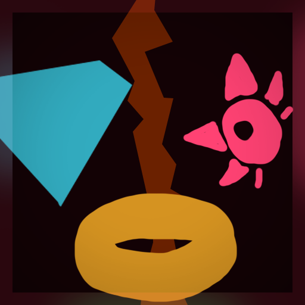
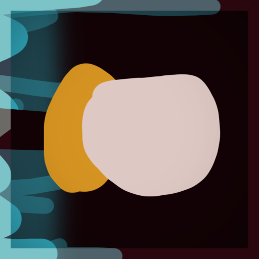
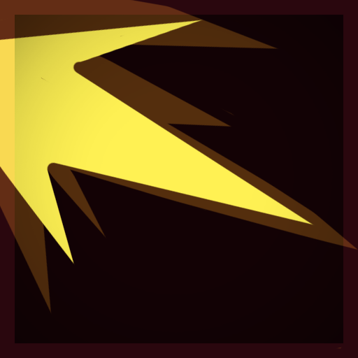
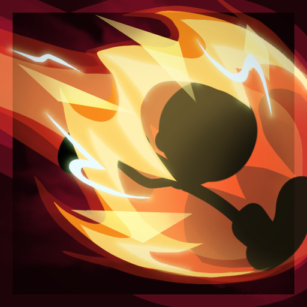
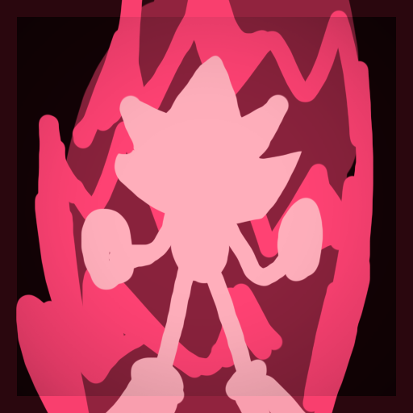

#  Shadow the Hedgehog
To test the latest version of the mod, download the ShadowLatest.zip file found [here](https://github.com/DS-GAMING-SE/ShadowRoR2/tree/master/Thunderstore) and add it to your mod list using your mod managers "import local mod" option.

description todo

# Skills

| Skill | Icon | Description |
| ---- | -------- | ---- |
| Passive - **All of Me** |  | Passive desc. |
| Primary - **Chaos Snap** |  | Primary desc. |
| Secondary - **Chaos Spear**  |  | Secondary desc. 
todo
  |
| Utility - **Boost** |  | Utility desc. 
todo
 |
| Special - **Chaos Boost** |  | Special Desc.
todo
 |

# Compatible Mods
- [LookingGlass](https://thunderstore.io/package/DropPod/LookingGlass/)
- [RiskOfOptions](https://thunderstore.io/package/Rune580/Risk_Of_Options/)

# Credits
| Name | Platform | Contribution|
| ---- | ---- | ------|
**DS Gaming** (ds_gaming) | Discord | Code and VFX |
**Thunder (Determined)** (keybladehero17) | Discord | Commissioned this mod |